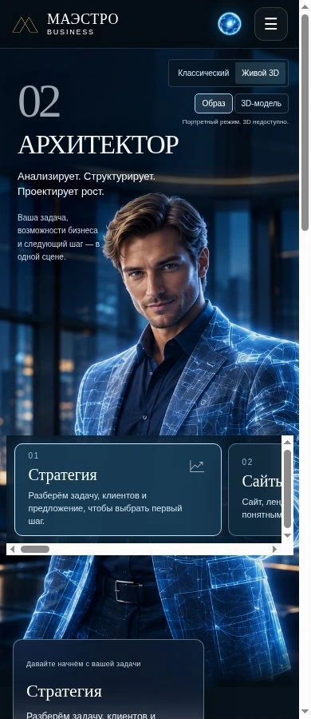
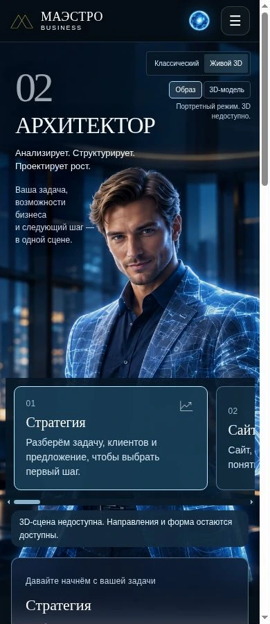
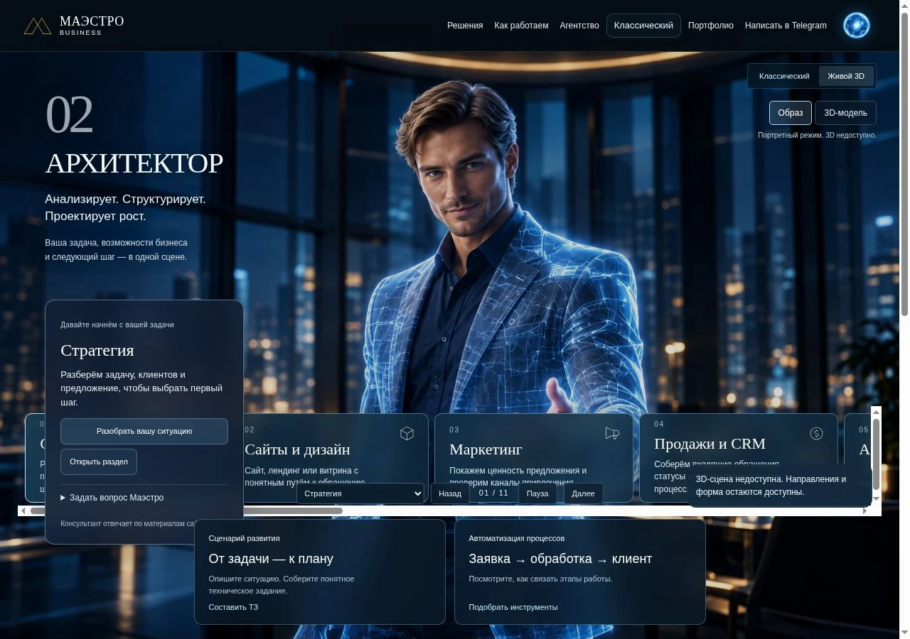
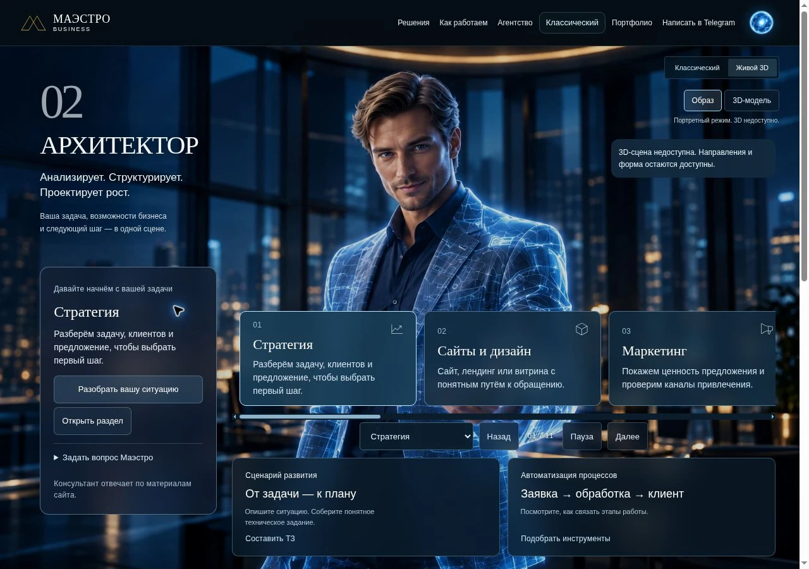

# Читаемость «Живого 3D» — 4 ноября 2026

Небольшая правка действующего варианта от `main` (`3a905552dc62ed35bd42e61b83bce73fa0508af1`). Замороженная ветка Архитектора не используется и не сливается. Изменение предлагается отдельным PR; публичный сайт не обновлялся.

## Направление

1. Продукт: посетитель малого бизнеса выбирает направление работы и следующий шаг.
2. Характер: спокойный, точный, человеческий.
3. Среда: существующий стеклянный офис и тёмные синие поверхности.
4. Главный образ: авторская фигура Маэстро остаётся в центре с прежним изображением и трёхмерными моделями.
5. Деталь: выбранное направление и одинаковые отступы связывают карусель с карточкой описания.

## Найдено и исправлено

| Наблюдение | Изменение |
|---|---|
| Мелкие подписи и действия | Основной текст карточек 14 px; пояснения 12 px; кнопки действий и управления высотой не менее 44 px; поле вопроса 16 px |
| Вертикальная полоса прокрутки внутри горизонтальной карусели | Отдельная горизонтальная прокрутка с тонкой полосой, увеличенная высота и привязка карточек к началу |
| В запасном режиме карточки закрывали описание и действия на компьютере | Карусель, управление и нижние карточки размещены правее панели описания |
| Фиксированные высоты мешали читать панель на телефоне | В запасном режиме нижние панели идут в обычном потоке и растут по содержимому |
| Неодинаковая видимость клавиатурного фокуса | Общая рамка фокуса в имеющейся палитре |

Добавлен один CSS-файл, около 3,4 КБ, подключён только на главной странице. Все правила ограничены активным режимом «Живой 3D». Размеры текста, действий и раскладка дополнительно ограничены запасным режимом `.next-static`; общая рамка фокуса работает в обоих режимах. Новых изображений, шрифтов, библиотек и сетевых вызовов нет.

## Что проверено

- До/после в настоящем браузере при ширине встроенной страницы 390 и 1280 px. Высота снимков 900 px; внешнее пустое поле кадра обрезано без масштабирования. Это проверка адаптивной страницы, не эмуляция конкретной модели телефона.
- Кнопка следующего направления меняет «Стратегия» на «Сайты и дизайн» и счётчик на 02/11.
- Тексты тела страницы, порядок разделов и все скрипты совпадают с исходной версией.
- Байты `architect-experience.js`, `architect-scene.js`, портрета, полной и мобильной трёхмерных моделей сохранены.
- Заявки, сообщения консультанту и контакты не отправлялись.

**Ограничение:** в этом браузере уже исходная версия показывает «3D-сцена недоступна». Проверен её запасной режим с портретом. Полный движок и взаимодействия модели требуют отдельной проверки перед слиянием. Правка не выдаётся за завершение разработки замороженной сцены.

## Снимки

| Ширина | До | После |
|---|---|---|
| 390 |  |  |
| 1280 |  |  |

## Мои улучшения (ChatGPT)

Устранены наложения панелей в запасном режиме без изменения двигателя, центральной фигуры и существующих переходов. Слабое устройство получает читаемый вариант даже при недоступном 3D.

Применён навык **Unslop**, автор **Damir Sokolovsky (@heydamir)**, лицензия **CC BY 4.0**. Источник: `github.com/heydamir/unslop`, зафиксированная версия `a6f121eee5f29c2f74976b75456feae8b66afb3a`. Авторство сохранено в установленной копии навыка. Ограничения владельца на композицию, тексты и бренд имеют приоритет.

## Исправление по ревью

Codex обнаружил риск наложения увеличенной панели в мобильной **работающей** 3D-сцене, которая в этом браузере недоступна для проверки. Размеры текста и действий теперь меняются только в наблюдаемом запасном режиме, где одновременно исправлена раскладка. Рабочая 3D-сцена сохраняет прежние размеры и позиции; общая рамка клавиатурного фокуса не меняет геометрию. Снимки запасного режима сохраняют силу: его правила и результат не изменились. Это ограниченная проверенная правка; полноценная сцена остаётся условием визуальной приёмки.
